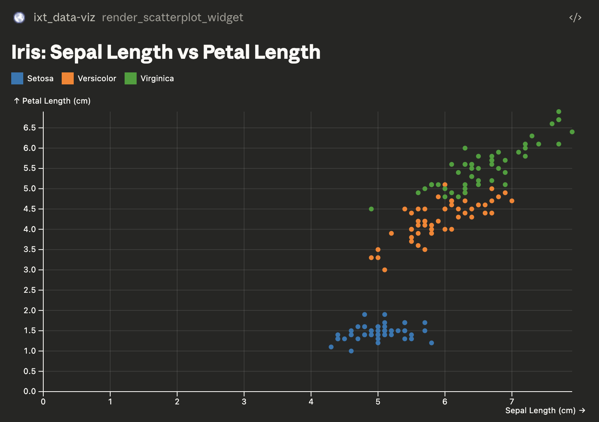

# MCP Data Visualization Lab

Generative UI for data visualization. This lab explores how MCP Apps and web
components can give LLM chat applications first-class data visualization tools.
The goal is to prove a white-label approach: a baseline chart library that can
be branded and embedded into chat experiences.



MCPJam Inspector: https://app.mcpjam.com/shared/edu-mcp-app-live/1CD8UxW3lT1FwVFXcGZM_

## What This Lab Explores

- MCP App patterns for data visualization in LLM chat
- Web component chart primitives built with Plot
- A white-label design system driven by host CSS variables
- Composition between web components and visualization vocabularies

## Goals

1. Build web component charts with Plot
2. Expose UI tools to LLMs for controlling and interacting with charts
3. Create a design system that adapts to host interfaces
4. Provide chart tools for:
   - Line chart
   - Bar chart
   - Scatterplot
5. Bonus: publish components as a package or registry

## Achieved So Far

- Bar chart MCP App widget
- Line chart MCP App widget
- Scatterplot MCP App widget
- MCP server wiring to serve MCP Apps to chat clients

## What’s Next

- Expand the chart catalog (compositional layouts, multi-series, annotations)
- Theming system based on host CSS variables
- Connect to a real data source (Postgres-backed reporting dashboard)
- Explore web component composition patterns for chart vocabularies

## Side Quests

- Build a separate MCP server for the reporting dashboard and connect it to chat
- Prove a host-injected theming system for MCP Apps
- Test composition patterns with Plot/D3 and vocabulary primitives

## Quick Start

```bash
# Install dependencies
bun install

# Start development
bun dev

# Build for production
bun run build
```

### Formatting and Linting

Format and lint the codebase using Biome:

```bash
# Format code
bun format

# Lint code
bun lint

# Type check
bun type-check
```

### Testing

Run tests across the monorepo:

```bash
# Run all unit tests
bun run test

# Run tests for specific apps
bun run test --filter=client
bun run test --filter=server

# Run E2E and visual regression tests
bun run test:e2e

# Update visual regression baselines
bun run test:e2e -- --update-snapshots
```

### Test Stack

- **Client**: Vitest 4.x with Browser Mode (Playwright), vitest-browser-react
- **Server**: Vitest 4.x with Node environment, @effect/vitest
- **E2E**: Playwright with visual regression testing

### CI/CD Workflows

| Workflow       | Trigger   | Purpose                       |
| -------------- | --------- | ----------------------------- |
| `check-client` | PR + main | Fast: lint, types, unit tests |
| `check-server` | PR + main | Fast: lint, types, unit tests |
| `post-merge`   | main only | Slow: E2E, visual regression  |

Visual regression baselines are stored in `e2e/smoke.spec.ts-snapshots/` and
should be committed to git. Update them when UI changes are intentional.

## Project Structure

```txt
.
├── apps/
│   ├── client/             # React frontend (Vite + React)
│   ├── server/             # Bun + Effect backend API
│   └── server-mcp/         # Model Context Protocol server
├── e2e/                     # Playwright end-to-end tests
├── packages/
│   ├── ai/                 # AI services and toolkits
│   ├── config-typescript/  # TypeScript configurations
│   ├── domain/             # Shared Schema definitions
│   ├── observability/      # OpenTelemetry setup
│   ├── presence/           # Presence tracking service
│   ├── widget-bar-chart/   # MCP App bar chart widget
│   ├── widget-line-chart/  # MCP App line chart widget
│   └── widget-scatterplot/ # MCP App scatterplot widget
├── docker-compose.yaml     # Docker Compose configuration for deployment
├── package.json            # Root package.json with workspaces
└── turbo.json              # Turborepo configuration
```

### Apps

| App          | Description                                                                                                     |
| ------------ | --------------------------------------------------------------------------------------------------------------- |
| `client`     | A [React](https://react.dev) app built with [Vite](https://vitejs.dev)                                          |
| `server`     | A [Effect Platform](https://effect.website) backend API                                                         |
| `server-mcp` | A [Model Context Protocol](https://modelcontextprotocol.io/) server built with [Effect](https://effect.website) |

### Packages

| Package                   | Description                                                                                                        |
| ------------------------- | ------------------------------------------------------------------------------------------------------------------ |
| `@repo/config-typescript` | TypeScript configurations used throughout the monorepo                                                             |
| `@repo/domain`            | Shared Schema definitions using [Effect Schema](https://effect.website/docs/schema) used by both client and server |
| `@repo/ai`                | AI tooling and service layers built on [@effect/ai](https://github.com/tim-smart/effect-io-ai)                     |
| `@repo/observability`     | Shared OpenTelemetry setup                                                                                         |
| `@repo/presence`          | Presence tracking service for WebSocket clients                                                                    |
| `widget-bar-chart`        | MCP App bar chart widget                                                                                           |
| `widget-line-chart`       | MCP App line chart widget                                                                                          |
| `widget-scatterplot`      | MCP App scatterplot widget                                                                                         |

## Development

```bash
# Start development server
bun dev
# Run specific app
bun dev --filter=client
bun dev --filter=server
bun dev --filter=server-mcp


# Build all apps
bun run build

# Test MCP server functionality (MCPJam Inspector)
bun --filter=server-mcp run inspector
```

## Deployment

To run the application using Docker, you can use the provided
`docker-compose.yaml` file.

First, ensure you have Docker and Docker Compose installed on your system.

Then, run the following command to build and start the services in the
background:

```bash
docker-compose up -d --build
```

This will start all three services: `client`, `server`, and `server-mcp`.

### Environment Variables

You can configure the deployment using environment variables:

```bash
# Example .env file
CLIENT_PORT=3000
SERVER_PORT=9000
MCP_PORT=9009
```

## Type Safety

Import shared types from the domain package:

```typescript
import { ApiResponse } from "@repo/domain/Api";
```

## Learn More

- [MCP Apps Spec](https://github.com/modelcontextprotocol/ext-apps/blob/main/specification/2026-01-26/apps.mdx)
- [MCP UI](https://github.com/MCP-UI-Org/mcp-ui)
- [Effect](https://effect.website/docs/introduction)
- [Plot](https://observablehq.com/plot/)
